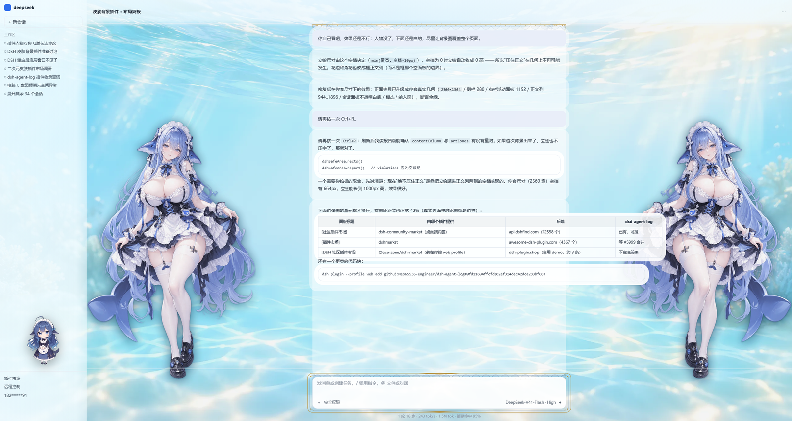
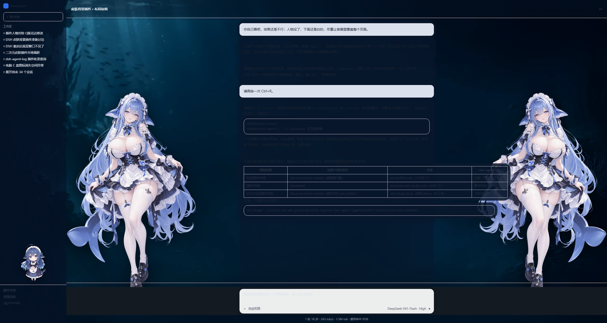

# Whale Girl · DSH 深海皮肤

给 DSH Desktop 换一身会呼吸的深海皮肤：**左右各一张镜像立绘**、
**昼夜两套背景**、蕾丝花边框住正文列、Q 版吉祥物在侧栏随机换表情 ——
并且**任何一块文字都有底**：美术再花也压不住字，也挡不住按钮。




<sub>最难的一种情况：**右栏展开**时正文列被挤到很窄，两侧立绘必然与正文重叠 ——
这时候靠的就是"分层文字底"（[预览](docs/preview-light-rightbar.png)）。</sub>

| | |
| --- | --- |
| 安装 | **一条命令**（装完重启一次），见下 |
| 实测环境 | DSH Desktop **2.0.15**（Windows / x64） |
| 运行依赖 | **零** —— 无 peerDependencies、无 install 钩子、无原生模块、无构建步骤 |
| 素材体积 | **1.01 MB / 8 个文件** |
| 代码许可 | MIT（**素材另附条款，见下**） |

---

## 安装

```sh
dsh plugin --profile desktop add github:Neo65536-engineer/dsh-skin-whale-girl
```

**就这一条。** `dsh plugin` 是转发给 pnpm 的；**注册到 `dsh.profile.bundles` 由 DSH 自动完成**
（包里声明了 `dsh.bundle.patch`，安装后 DSH 会自己把它写进 bundles）——
**不需要手改任何 JSON**。

> **装完要重启一次 DSH Desktop。** 宿主侧（素材路由 / 自检报告通道）只在启动时加载一次。
> 之后如果只改了 `lib/client.js`（浏览器侧），**刷新页面（`Ctrl+R`）就生效**，不用重启。

本地开发就按路径装：

```sh
git clone https://github.com/Neo65536-engineer/dsh-skin-whale-girl
dsh plugin --profile desktop add ./dsh-skin-whale-girl
```

卸载：

```sh
dsh plugin --profile desktop remove dsh-skin-whale-girl
```

（bundles 里那一行也会随之自动移除。）

## 特性

- **左右镜像双立绘**：同一张素材，左侧 `scaleX(-1)`。尺寸随窗口连续变化
  —— 高度约视口的 **2/3**，下限是上限的一半（不再是"档位跳变"）。
- **昼夜背景**：默认跟随 DSH 主题（深色 = 夜色 / 浅色 = 白昼）；
  按 **`Ctrl+Alt+N`** 可手动循环「跟随主题 → 夜 → 昼」，选择会记住。
  也可以在控制台用 `dshSkinWhaleGirl.setBackdrop('night')`。
- **文字永远有底**（三层，可见即可读）：
  1. 正文列一层**浅底**（地板），任何"跑出卡片"的内容至少落在它上面；
  2. 非正文行（思考 / 调用工具 / 已编辑文件）再抬一档浅底，和正文输出区分得开；
  3. 正文块、代码块、**表格**、卡片各自一层**实底** —— 关键在这：
     比容器宽的元素（例如单元格不换行的对照表）**自己的底会跟着它一起变宽**，
     所以最右一列也不会挂在背景上。
- **Q 版**：贴在侧栏、坐在底色之上；三张表情每 5–11 秒随机交叉淡入（不会连续重复同一张）。
- **花边**：顶部蕾丝带 + 角花 + **输入框九宫格描金画框**
  （内联 SVG，零字节、任意高度都不变形）。
- **按钮永远点得到**：美术层坐在官方 UI **之下**，结构上不可能拦截点击；
  引擎另外做"控件中心点命中测试"断言。
- **可完整卸载**：改动都记在还原账本里，卸载后官方样式逐元素还原。

## 内置的安全区引擎

皮肤不是靠猜 DOM 来避让的 —— 包里内置了一个**运行时安全区引擎**：
它测量官方 UI 的保护区（标题栏 / 会话头 / 侧栏 / 右栏 / 输入区 / 正文列）、
把这些几何发布成 CSS 变量与状态属性、在顶部带铺一层可读衬底、
并提供越界自检与可视化。

为什么是"内置"而不是一个单独要装的包：**分成两个包时，用户得先 clone 再从子目录装第二个**
—— 那就不叫即装即用了。它自身零依赖，卸载时和皮肤各自还原。

## 控制台自检

引擎在 `window` 上留了接口，出问题时不用开 DevTools 翻 DOM：

```js
dshSafeArea.rects()      // 当前测到的全部几何
dshSafeArea.report()     // 关键控件中心点是否还命中它自己（violations 应为空数组）
dshSafeArea.visualize()  // 快捷键 Ctrl+Shift+S：把所有保护矩形画出来
dshSkinWhaleGirl.backdrop          // 'auto' | 'night' | 'day'
dshSkinWhaleGirl.setBackdrop('day')
```

## 已知限制（诚实说）

- **只在 DSH Desktop 2.0.15 上实测过。** 官方 class 名带哈希前缀、DOM 结构也可能变，
  皮肤里有一部分钩子是 `[class*=...]` 片段和 `data-*` 属性 ——
  DSH 升级后有失效的可能。真失效了请开 issue，附上 `dshSafeArea.report()` 的输出。
- **手动切夜（`Ctrl+Alt+N`）属于"错配"场景**：界面还在亮色档时官方文字是深色，
  而夜色背景很暗，地板那层浅底挡不住深色字。想要夜景请优先**直接把 DSH 切到深色主题**。
- 皮肤不改官方 z-index、不接管官方浮层，因此官方对话框 / 菜单永远是**不透明**的
  —— 这是有意的，浮层上盖美术只会让文字更难读。
- 立绘素材本身尺度偏性感（露背 / 吊带袜），自用无碍；若你要基于本仓二次发布，
  请先自行评估目标平台的内容政策。

## 素材与商标

- **素材是 AI 生成图**，角色为同人形象「鲸鱼娘」，原型作者为 **上善**。
  素材**不在 MIT 范围内**：请勿商用、请勿移除署名；二次分发请同时保留本节的署名信息。
  详见 [NOTICE](NOTICE)。
- 主立绘原图腰部缎带上原有的第三方商标字样，已在**构建期用 inpaint 抹除**
  （脚本见 `build/build_assets.py`），因此镜像后也不会出现反字。
- 本项目是**第三方作品，与 DeepSeek 官方无关**，不包含任何官方素材或代码。

## 开发

```sh
# 素材重建（需要原图；产物已随仓提交，普通用户不需要跑）
python build/build_assets.py <原图目录>
```

预览图不是手绘模拟图：它们是在**真 CSS + 真素材**上用无头 Chromium 渲染出来的
（早期的预览是 Python 合成的，几何假设有误，"看着完美、真机却不行" —— 已废弃）。
渲染脚本目前没随仓提供；如果你要改布局并想复现同样的预览，开个 issue 我把它整理进来。

## 许可

- 代码：MIT，见 [LICENSE](LICENSE)
- 美术素材：见 [NOTICE](NOTICE)（非 MIT，保留署名、禁止商用）
